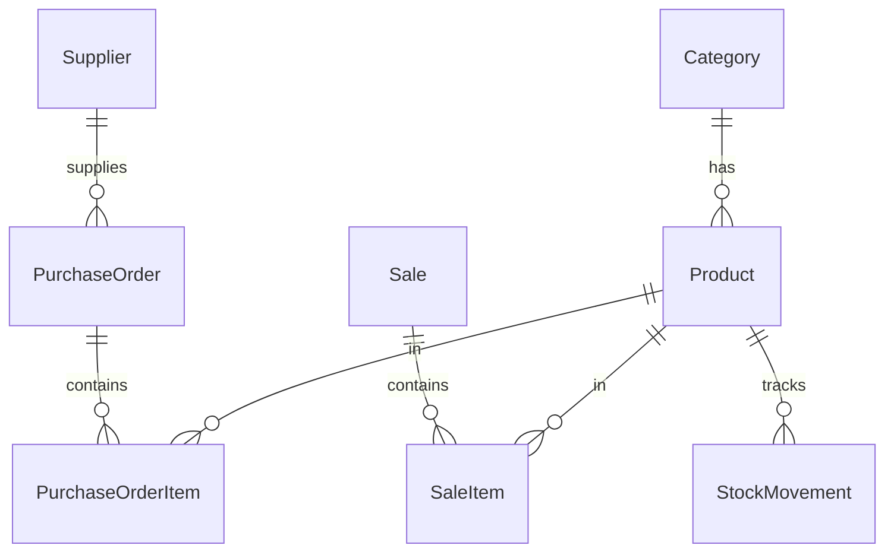

# Kiến trúc và thiết kế dữ liệu

## 1. Kiến trúc tổng quan
ASP.NET Core MVC một project, tách tầng rõ ràng:

```
Browser -> Controller -> Service (logic nghiệp vụ) -> AppDbContext (EF Core) -> SQL Server
                \-> View (Razor + Bootstrap)
```
- Controller mỏng, chỉ điều phối.
- Service chứa toàn bộ quy tắc nghiệp vụ và transaction.
- Entity không đưa trực tiếp ra View, dùng ViewModel.

## 2. Entity chính
| Entity | Trường chính |
|---|---|
| ApplicationUser (Identity) | Id, Email, FullName |
| Category | Id, Name, IsDeleted |
| Product | Id, Name, Barcode (unique), CategoryId, CostPrice, SellPrice, Unit, StockQuantity, LowStockThreshold, IsDeleted, RowVersion |
| Supplier | Id, Name, Phone, Address, IsDeleted |
| PurchaseOrder | Id, SupplierId, CreatedAt, CreatedByUserId, TotalAmount, Note |
| PurchaseOrderItem | Id, PurchaseOrderId, ProductId, Quantity, UnitCost |
| Sale | Id, Code, CreatedAt, CashierId, TotalAmount, AmountPaid, ChangeAmount, Status (Completed/Cancelled), CancelReason |
| SaleItem | Id, SaleId, ProductId, Quantity, UnitPrice (chốt giá tại thời điểm bán), UnitCost |
| StockMovement | Id, ProductId, Type (Purchase/Sale/Adjust/Cancel), Quantity (+/-), RefId, CreatedAt |

## 3. Quan hệ
- Category 1 - n Product
- Supplier 1 - n PurchaseOrder; PurchaseOrder 1 - n PurchaseOrderItem n - 1 Product
- Sale 1 - n SaleItem n - 1 Product
- Product 1 - n StockMovement



## 4. Services
| Service | Trách nhiệm |
|---|---|
| IProductService | CRUD, tìm kiếm, phân trang, danh sách hàng sắp hết |
| ICategoryService | CRUD danh mục |
| ISupplierService | CRUD nhà cung cấp |
| IPurchaseService | Tạo phiếu nhập, tăng tồn kho, ghi StockMovement (trong transaction) |
| ISaleService | Tạo hóa đơn, kiểm tra tồn, trừ kho, ghi StockMovement, hủy hóa đơn (transaction) |
| IReportService | Doanh thu, top bán chạy, lợi nhuận gộp |

## 5. Quyết định thiết kế
- **SQL Server** làm cơ sở dữ liệu (EF Core Code First + Migrations). Chuỗi kết nối `DefaultConnection` được đặt trong `appsettings.json` (do LocalDB dùng Windows Auth không chứa mật khẩu). Chi tiết cài đặt trong `docs/database-setup.md`.
- **Bảo mật & Phân quyền**:
  - Dùng **Fallback Authorization Policy**: Mặc định mọi request đều bắt buộc đã đăng nhập (`RequireAuthenticatedUser()`), chỉ các action công khai mới gắn `[AllowAnonymous]` (`Login`, `AccessDenied`).
  - Phục vụ file tĩnh: Cấu hình `UseStaticFiles()` trước `UseAuthorization()` và gọi `MapStaticAssets().AllowAnonymous()` để các tài nguyên tĩnh (`/lib`, `/css`, `/js`, `favicon`) được phục vụ không cần đăng nhập, tránh chuyển hướng 302 trên tài nguyên giao diện.
  - Chống Brute-force: Bật `lockoutOnFailure: true` khi đăng nhập, khóa 5 phút sau 5 lần nhập sai.
  - Phân quyền theo vai trò Identity Roles: `Admin` (quản trị toàn hệ thống) và `Cashier` (thu ngân).
- **Chốt giá** (UnitPrice, UnitCost) vào SaleItem để báo cáo không đổi khi giá sản phẩm thay đổi.
- **Xóa mềm** cho dữ liệu danh mục; hóa đơn không xóa.
- **Transaction** bao quanh mọi thao tác thay đổi tồn kho.
- Chống bán quá tồn khi nhiều thu ngân cùng bán: cột `RowVersion` (`rowversion`) trên Product làm concurrency token, kết hợp transaction. Bắt `DbUpdateConcurrencyException` và cho thu ngân thử lại.
- Index: unique trên `Product.Barcode`; index trên `Sale.CreatedAt` để báo cáo theo ngày nhanh.

## 6. Seed dữ liệu
- Vai trò: `Admin`, `Cashier`.
- Tài khoản mẫu (Admin & Cashier): Không hard-code mật khẩu trong source code. Đọc từ Configuration (`SeedAdmin` và `SeedCashier`) cấu hình qua **User Secrets**, và chỉ tự động seed khi ứng dụng chạy ở môi trường **Development**.
- Vài danh mục và sản phẩm mẫu để thử nghiệm (sẽ thực hiện ở Module 2).

